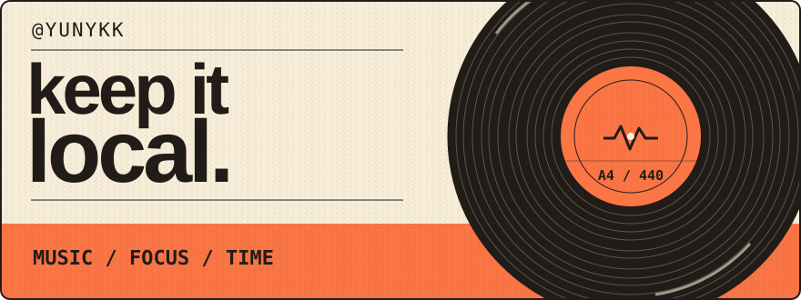

# hey, i'm Vadym.

i keep my music on disk. i wanted a player that made that feel good. that's how Kitto started.

## [Kitto](https://github.com/Yunykk/Kitto) — play the files you kept.

A music player for your own collection. It picks up where you left off. It also has a Tape Deck theme because I like when software feels like an object.

**[Get Kitto](https://github.com/Yunykk/Kitto/releases/latest)** · Windows, Linux, Android preview

## Two other things I made

**Nerve.** A timer for the work you said you'd do. Connect a project to a goal, start a session, and watch the connection show up in World. [Open Nerve](https://yunykk.github.io/Nerve/) · [Source](https://github.com/Yunykk/Nerve)

**WorkCount.** A shift timer for the hours you actually worked. Start, take a break, clock out. Your shift and estimated pay are there when you need them. [See WorkCount](https://github.com/Yunykk/workcount)

Why 440?

It's the A4 reference Kitto uses for pitch shifting. In **Settings → Tuning**, try **432 Hz** and then go back to **Original**. The pitch moves. The tempo stays.

[Studio](https://yvvstudio.com/) · [Telegram](https://t.me/yunnnyk)
